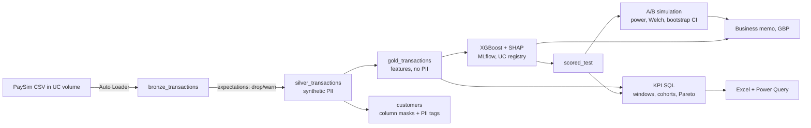

# Fraud Lakehouse on Databricks

End-to-end fraud analytics on **Databricks**: a Lakeflow pipeline builds bronze, silver and gold **Delta** tables
with data-quality expectations; **Unity Catalog** governs PII with column masks, tags and grants; analytical
**SQL** produces KPIs, cohorts and concentration analysis; an **XGBoost** model explains every decision with
**SHAP** and is tracked and registered with **MLflow**; an **A/B simulation** tests whether a stricter fraud rule
reduces losses; and the results become an **Excel** report (with a Power Query script) and a one-page **business
memo** with the impact in GBP. One **Job** runs it all.

## Results

<!-- RESULTS:START -->
Results appear here after the Databricks Job runs (published from its `results_bundle.zip`).
<!-- RESULTS:END -->

Memo: [`results/memo.md`](results/memo.md) · Excel: [`results/fraud_report.xlsx`](results/fraud_report.xlsx) ·
Power Query: [`results/power_query_daily_kpis.m`](results/power_query_daily_kpis.m)

## What each part shows

| Skill | Where | What it does |
|---|---|---|
| Databricks: Delta, Lakeflow, Jobs | `pipeline/fraud_pipeline.py`, `databricks.yml` | Auto Loader ingestion; bronze, silver and gold Delta tables; one Job runs setup, pipeline, governance, training, A/B test and report |
| Data quality | `fraudlake/transforms.py` (`CRITICAL`, `WARN`) | Lakeflow expectations: critical failures dropped, warnings counted; failure counts read from the pipeline event log into the results |
| Data governance | `notebooks/02_governance.py` | PII isolated in silver; `customers` table with column masks (`pii_readers` see values, others see `***`), PII column tags, grants; lineage in Catalog Explorer |
| Analytical SQL | `fraudlake/kpis.py` | Window functions (7-day rolling sums, `LAG`, `RANK`, `NTILE`, running Pareto share), receiving-account cohorts, model performance by day |
| XGBoost + SHAP | `fraudlake/model.py` | Time-based split, cost-based threshold, top-3 reasons for every scored transaction, global importance; a second model without PaySim's balance-error artefact |
| MLflow | `notebooks/03_train_ab.py` | Params, metrics and models for both feature sets; the main model registered in Unity Catalog (`workspace.fraud.fraud_xgb`) |
| Statistics, A/B testing | `fraudlake/abtest.py` | Power analysis (sample size for a 10% effect), stable random assignment, Welch t-test, bootstrap CI, decision rule |
| Excel / Power Query | `fraudlake/excel.py` | Workbook with KPI sheets and a chart; Power Query M script that rebuilds the daily KPIs from the CSV exports |
| Business "so what" | `fraudlake/memo.py` | One-page memo generated from the results: GBP impact, recommendation, caveats |

The same transforms, SQL and model code run locally with PySpark (`python -m fraudlake.run_local --data <csv>`)
and are covered by tests on PaySim-like synthetic data (`pytest`, needs Java).

## Run it on Databricks Free Edition

1. Sign up at **databricks.com/learn/free-edition** (free, no card).
2. Download PaySim from Kaggle (`ealaxi/paysim1`, the `PS_2017...log.csv` file).
3. In the workspace: **Workspace > Create > Git folder**, URL `https://github.com/ChrishA-tech/fraud-lakehouse`.
   Run `notebooks/01_setup` once (creates the schema and volumes), then upload the CSV to
   **Catalog > workspace > fraud > Volumes > raw**.
4. Create the pipeline and job, either with the CLI (`databricks bundle deploy && databricks bundle run fraud_job`)
   or in the UI from `databricks.yml`.
5. Download `exports/results_bundle.zip` from the volume and run `python3 publish.py` to add the results here.

## Honest limits

- **PaySim is simulated** (Lopez-Rojas et al., 2016; Kaggle, CC BY-SA 4.0). Amounts are simulated currency, shown
  as GBP for illustration. The balance-error features nearly separate fraud because of how the simulator books it,
  so the model is also reported without them.
- **The A/B test is an offline simulation** on known outcomes, not a live experiment; the memo says so.
- **PII is synthetic**: fake names, `example.com` emails and Ofcom drama-range phone numbers, added to demonstrate
  masking. PaySim contains no personal data.
- Free Edition limits (one SQL warehouse, one pipeline per type, five concurrent job tasks) shape the design;
  the job fits within them.
